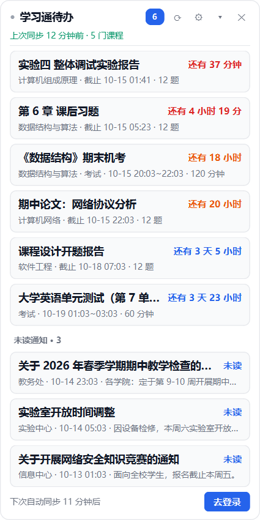

# 学习通小助手

一个只读的 Windows 桌面小程序：定时抓取学习通（超星）网页端的**待截止作业**、**新作业**、
**未完成考试**和**未读通知**，在桌面右上角留一张悬浮清单，并在关键时间点弹 Windows 通知提醒。

> 全程**只读**：只调用"查列表 / 看详情"这类浏览接口，不会提交作业、不会答题、不会刷课，
> 也不会在服务端做任何写操作。



---

## 一、功能

| 功能 | 说明 |
| --- | --- |
| 桌面悬浮清单 | 无边框圆角卡片，可拖动，位置自动记忆；高度随条数自适应，超出的部分在卡片里滚动；默认不置顶，可在设置里勾上 |
| 只看没做完的 | 已过期、已提交的一律不占地方：列表只按**截止/开考时间**从近到远排未完成作业与考试 |
| 右键滑动移除 | 按住某条待办的右键，将鼠标拖出整个卡片的左侧或右侧边缘后松手，移出作业清单；窗口内松手一律回弹。只在作业清单隐藏，可在设置里恢复 |
| 桌面常驻 | 独立透明浮窗；主动收起到托盘后保持隐藏 |
| 自定义背景 | 设置 → 界面选择背景图，自动居中裁剪到圆角卡片；可调文字保护蒙层，也可恢复纯色背景 |
| 数据目录 | 首次登录前选择本地数据文件夹；设置 → 维护可迁移位置或清除全部本地数据 |
| 倒计时分级配色 | 剩余 >24h为蓝、≤24h为橙、≤6h变红 |
| 提醒分级 | 新作业/新考试/新通知；截止前 24h / 6h / 1h 各提醒一次；考试前 24h / 1h；同一档只响一次，跨档后才补下一次 |
| 免打扰 | 默认 23:00–7:00 不弹窗，安静时段照样同步；此时只有 ≤1 小时的加急提醒会弹 |
| 通知中心 | 抓未读通知，有未读时显示在列表底部（可关） |
| 托盘常驻 | 托盘图标右键：显示/隐藏、立即同步、打开学习通、设置、退出 |
| 单实例 | 重复启动只会唤起已有实例 |
| 不误触 | 卡片上的条目点击不会触发任何跳转 |
| 开机自启 | 设置里有一键开关，自动写注册表 `HKCU\...\CurrentVersion\Run`，关闭自动删除注册表内容 |
| 凭据安全 | 账号密码用 Windows DPAPI（当前用户）加密后存 `data/credentials.bin`，不会上传到任何地方 |
| 抓取克制 | 默认 30 分钟一次、请求间隔 0.7 秒、串行、带随机抖动；只对未交作业拉详情页 |

## 二、安装

### 方式一：直接用打包好的 exe（推荐）

到 **[Releases](https://github.com/led629263224-cmyk/xxt-assistant/releases/latest)** 下载exe文件，放到任意普通文件夹（因为没有微软数字签名，可能会报不信任，请按照实际情况运行），双击即可，**不需要装 Python 环境**。
里面的 `xxt-assistant-usage.txt` 是用户三步说明。

> 首次运行 Windows 可能提示"已保护你的电脑"，点「更多信息」→「仍要运行」即可（exe 未购买数字签名）。
> 别放 `C:\Program Files`里面，那里没有读写权限。

### 方式二：从源码跑（想改代码）

需要 **Python 3.10+**（本次发行版使用 3.13）。在源码目录执行：

```powershell
python -m venv .venv
.venv\Scripts\python.exe -m pip install -i https://pypi.tuna.tsinghua.edu.cn/simple -r requirements.txt
```

> 国内直连 PyPI 很慢甚至超时，上述为清华镜像地址 `-i https://pypi.tuna.tsinghua.edu.cn/simple`。

## 三、使用

1. 启动程序（在源码目录下执行命令）：

   - `.venv\Scripts\pythonw.exe -m xxt.main` —— 无控制台窗口，日常使用
   - `.venv\Scripts\python.exe -m xxt.main` —— 带控制台看日志，排错使用
2. 点击卡片上的「去登录」，首次登录时先确认或选择**本地数据保存位置**，
   填学习通的**手机号/学号 + 密码**，按需勾选"记住账号密码"。
   登录在后台进行；成功后立即开始同步，卡片逐门课程显示进度与已获取的作业，无需收起再打开。
3. 卡片上的 `⟳` 立即同步、`⚙` 打开设置、`✕` 收起到托盘（不是退出）。
   条目**左键点击无触发事件**；**按住右键可以水平滑动**，鼠标越过整个卡片的左边缘或右边缘后松手才会移除，窗口内松手回弹。
   列表超出一屏时用滚轮滚动。
4. 退出：托盘图标右键 → 退出。

### 命令行（排错用）

```powershell
.venv\Scripts\python.exe -m xxt.main --sync-once           # 不开界面同步一次并打印清单
.venv\Scripts\python.exe -m xxt.main --dump worklist --course 0   # 存原始页面到 data\dump\
.venv\Scripts\python.exe -m xxt.main --reset               # 清除 cookie 与保存的账号密码
.venv\Scripts\python.exe -m xxt.main --tray                # 只留托盘不弹窗口（开机自启用）
.venv\Scripts\python.exe tools\test_notify.py              # 自测提醒：先推演规则，再真弹 4 条系统通知
```

> 日志里每条同步会带 `提醒 N`，`data\app.log` 里还能看到 `已弹提醒[h1]：…` 这样的记录，方便确认提醒到底发没发。

## 四、目录结构

```
xxt/
  config.py     配置读写 + DPAPI 凭据        crypto.py   AES-128-CBC 登录加密 / DPAPI 封装
  client.py     学习通只读接口客户端         parse.py    HTML/JSON 解析、时间补年份
  store.py      SQLite 存储与增量 diff       notify.py   提醒规则引擎（分档、去重、免打扰）
  sync.py       采集编排 + 后台定时线程       startup.py  开机自启（注册表）
  ui/widget.py  悬浮清单                     ui/dialogs.py  登录 / 设置对话框
  ui/tray.py    托盘图标与 Toast             ui/style.py    浅色/深色配色
  main.py       入口（GUI / 无界面命令）
run.py          直接运行 / PyInstaller 打包入口
tools/preview_card.py   把界面渲染成 docs/ 下的预览图，改 UI 时用
tools/smoke_ui.py       界面自检（右键移除、恢复、排序等 15 项）
tools/snapshot_live.py  用真实数据库渲染卡片，检查使用
tools/test_notify.py    提醒功能测试（规则推演 + 真弹 4 条系统通知，跑在临时目录里）
tests/                  68 个测试：python -m unittest discover -s tests -t .
tools/test_gui_flow.py   模拟主程序同步、迁移目录与清理数据的离线回归
tools/test_desktop_presence.py  Windows 原生回归：独立应用在前台
data/                   运行时数据：xxt.db / session_cookies.json / credentials.bin
                        / signatures.json（课程页签名缓存）/ app.log
```

### 关于同步速度

同步为每完成一门课程就入库并刷新卡片，详情页的截止时间随后逐项补全。
个人信息和课程列表共用短时缓存，避免重复请求个人主页。界面刷新统一在 GUI 线程执行。
首次完整扫描仍受课程数量、网络和请求限速影响；显示已有结果不再等待整轮扫描结束。

同步耗时取决于课程数量和网络状态，请求间隔默认 0.7 秒。首次扫描需建立课程页签名缓存，后续同步会复用有效缓存。

data/signatures.json` 里记了当时的会话指纹，换账号或重新登录会自动作废重拉，可以放心删。

## 五、设置项

设置窗口分四个标签页：

- **同步**：自动同步间隔（分钟）、请求限速（秒/请求）、作业详情刷新周期（小时）。
- **提醒**：总开关、截止提醒档位（默认 `24,6,1` 小时）、考试提醒档位（默认 `24,1`）、
  免打扰时段、新作业/新考试/新通知提醒开关。
- **界面**：窗口置顶（**默认关闭**，需要时自己勾上）、深色主题、在列表底部显示未读通知、卡片不透明度、开机自启、背景图及文字保护蒙层。
- **维护**：显示当前保存的账号并可一键清除；显示"已从列表移除 N 项"，可一键恢复被移除的条目；打开数据目录。
  可更改数据存放位置，保存后**自动迁移**；「清除全部本地数据」经确认后退出登录，清理本地凭据、缓存、待办、背景图和设置，并关闭开机自启。
  清理前会等待当前请求结束，不会删除所选文件夹中的其他文件，也不影响学习通服务器上的内容。

选择自定义位置后，项目目录只保留 `storage.json` 作为位置记录，`config.json` 和运行数据位于所选目录。
背景图会复制为数据目录中的 `background.png`，原图移动或删除不影响已保存的背景。
托盘右键菜单支持随浅色 / 深色主题切换的圆角样式。

> 也可以直接编辑根目录的 `config.json`（重启生效）。

## 六、常见问题

**Q：提示"用户名或密码错误"但网页能登录？**
学习通对非常用设备可能要求图形验证码或二次验证，程序无法处理。请在网页端登录一次，
或换用手机号（而不是学号）再试。

**Q：某个作业的截止时间显示"未知"？**
详情页解析失败（题型/页面结构差异），程序会跳过并继续，不会中断整个同步。

**Q：会不会被封号？**
程序只读、低频（默认 30 分钟一次）、串行限速，与正常浏览行为接近。但**请勿**把间隔改得
过小或频繁手动同步；本项目不做任何提交、答题、刷课动作，放心使用。

**Q：卡片不见了？**
它在托盘里。右键托盘图标 → 显示任务清单。
Windows 使用独立浮窗保持透明背景正常绘制。勾选「窗口始终置顶」会切换到应用前方显示的模式。

## 七、打包成 exe 文件

在源码目录里一条命令即可（脚本会自动带上图标、排掉用不到的 Qt 模块）：

```powershell
.venv\Scripts\python.exe -m pip install pyinstaller
.venv\Scripts\python.exe tools\build_exe.py
```

产物是 `dist\xxt-assistant-v1.02.exe`（单文件，约 52 MB）。
`dist\xxt-assistant-usage.txt` 使用说明。

> 已发布到 GitHub Release。
> 已发布的版本见 [Releases](https://github.com/led629263224-cmyk/xxt-assistant/releases)。

几个已经处理好的点：

- `xxt/config.py` 的 `_base_dir()` 会识别冻结场景：打包后 `config.json` 和 `data\`
  都在 **exe 同目录**下，所以放在任意普通文件夹就能用（别放 `C:\Program Files`，
  那里没有读写权限）。
- 图标来自 `assets\icon.png`，用 `tools\make_icon.py` 生成多尺寸 `icon.ico`；想换图标
  就替换这张图再跑一次它。
- `run.py` 兜住了未捕获的异常：写 `data\crash.log` 并弹框提示，因为 `-w` 打包后没有控制台。
- 日志在任何情况下都会写 `data\app.log`。

> 卡片的「窗口始终置顶」默认是**关闭**的。

## 八、说明

- 本项目为个人学习/效率工具，参考了开源项目 [Xuexitong-mcp](https://github.com/DanMo661/Xuexitong-mcp)（MIT）
  公开的接口结论，代码为自行实现，未引入该项目的任何依赖。
- 与超星/学习通官方无关。接口随时可能变更；请遵守学校与平台的使用规定，仅用于管理自己的待办，提升学习效率。
